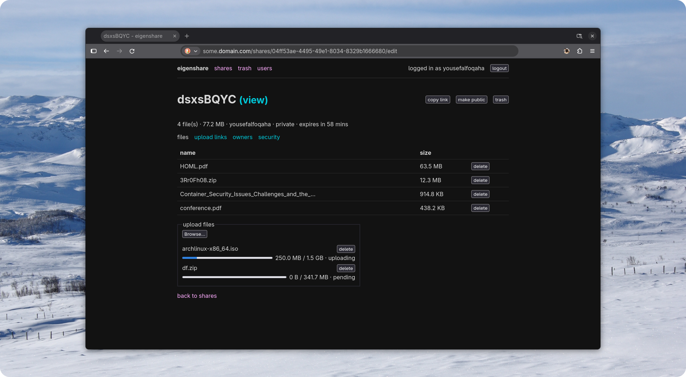

# <div align="center">Eigenshare</div>

Eigenshare is a lightweight self-hosted file sharing platform with fast, resumable uploads.



# Features

- Share files using a link
- Upload files of any size with resumability
- Upload links for uploading without an account
- Set an expiry date for shares
- Security with passwords and size limits
- User management with roles
- Mobile-responsiveness
- < 20MB single binary written in Go

## Planned features

- S3 storage provider support
- LDAP authentication

# Docker installation

1. Copy this `compose.yml` file:

```yaml
services:
  eigenshare:
    image: ghcr.io/yousefalfoqaha/eigenshare
    restart: unless-stopped
    ports:
      - 8080:8080
    environment:
      - TRUST_PROXY=false # set to true if behind a reverse proxy
    volumes:
      - "./data:/data"
```

2. Run `docker compose up -d`

Eigenshare is now listening on `http://localhost:8080` in the browser, enjoy!

# Environment variables

| Variable          | Default          | Description                                                                                                                                                                                                           |
| ----------------- | ---------------- | --------------------------------------------------------------------------------------------------------------------------------------------------------------------------------------------------------------------- |
| `PORT`            | `8080`           | The port the application listens on.                                                                                                                                                                                  |
| `DATA_PATH`       | `data`           | The directory path where application data is stored.                                                                                                                                                                  |
| `SECRET`          | _Auto-generated_ | Used for cryptographic operations. If not set, a 32-byte secret is automatically generated and saved to `DATA_PATH/.secret`.                                                                                          |
| `TRUST_PROXY`     | `false`          | Set to `true` if the application is running behind a trusted reverse proxy. When enabled, it trusts the `X-Real-IP` and `X-Forwarded-For` headers.                                                                    |
| `RATE_LIMIT`      | `5`              | General rate limit for standard incoming page requests.                                                                                                                                                               |
| `BURST_LIMIT`     | `10`             | Maximum burst limit for standard incoming page requests.                                                                                                                                                              |
| `API_RATE_LIMIT`  | `10`             | Rate limit specifically for API endpoints (mostly used for file uploads and data streaming).                                                                                                                          |
| `API_BURST_LIMIT` | `30`             | Maximum burst limit for API endpoints (mostly used for file uploads and data streaming).                                                                                                                              |
| `CHUNK_SIZE_MB`   | `50`             | The chunk size for data transfers, in megabytes. Keep this value below the maximum upload limit of your reverse proxy or CDN. For example, Cloudflare's free tier limits requests to 100 MB.                          |
| `PUID` and `GUID` | `1000`           | The user and group ID of the user who should run the app inside the Docker container and own the mounted volume files. You can get the `PUID` and `GUID` of your user on your host machine by using the command `id`. |
